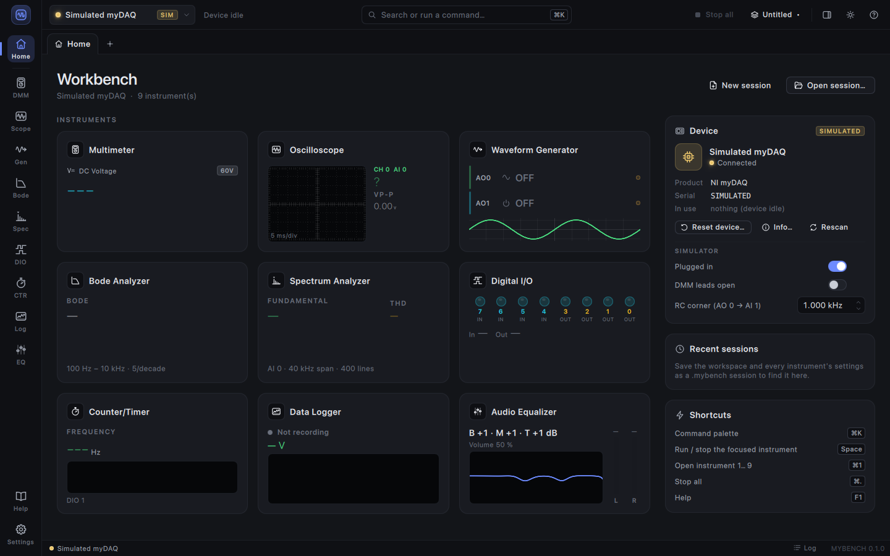
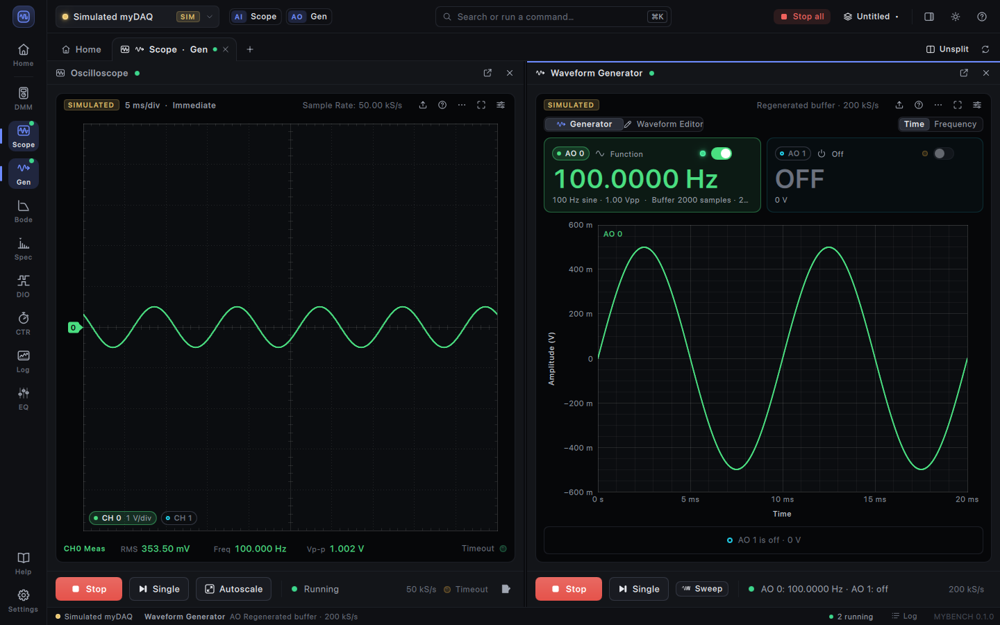

# MYBENCH

**An open-source instrument suite for the NI myDAQ** — multimeter, oscilloscope, waveform
generator, Bode and spectrum analyzers, digital I/O, counter/timer, data logger and audio
equalizer in one modern window, on macOS, Linux and Windows.

MYBENCH replaces NI ELVISmx for the myDAQ. It talks to the device directly over USB through
its own driver library, [`libmydaq`](docs/libmydaq.md) (plain C, libusb only), so no NI
software is needed. A realistic simulated myDAQ is built in: every instrument works without
hardware.





> MYBENCH is an independent project, not affiliated with or endorsed by NI (Emerson). "NI",
> "myDAQ" and "ELVIS" are trademarks of their owners.

## Instruments

All ELVISmx myDAQ instruments are here, merged where the hardware shares a resource, plus
extras. The app shares one device connection between them; a resource arbiter pauses an
instrument (with a banner and a Resume button) when another one takes the analog input or
output it was using.

| Instrument | Replaces | Highlights |
|---|---|---|
| **Multimeter** | DMM | DC/AC volts, DC/AC current, resistance, diode, continuity (with tone); trend chart, statistics (min/max/avg/σ), hold, relative, logging |
| **Oscilloscope** | Scope | AI0/AI1 and audio in, ELVISmx-exact acquisition and trigger modes, draggable trigger level/position, measurements, math, FFT, XY, persistence, reference traces, roll mode |
| **Waveform Generator** | FGEN + ARB + Waveform Editor | AO0 and AO1 independently: sine/square/triangle/…, sweeps, arbitrary waveforms from the built-in editor, DC level; both channels in one hardware-timed task |
| **Bode Analyzer** | Bode | magnitude/phase sweeps, overlay and compare, −3 dB and phase-margin markers, export |
| **Spectrum Analyzer** | DSA | windows, averaging, harmonic markers, THD, spectrogram/waterfall |
| **Digital I/O** | Digital Reader + Writer | per-line direction, LEDs, switches, patterns, timeline of line states |
| **Counter/Timer** | — | frequency, period, pulse width, edge count, encoders; PWM generator; FREQOUT |
| **Data Logger** | ELVISmx "Data Logger" | long AI0/AI1 (and DMM) recordings to tab-separated files, scroll-back chart |
| **Audio Equalizer** | ELVISmx "Audio Equalizer" | audio in → 3-band EQ → audio out in real time, level meters, before/after spectrum |

The shell around them: Home dashboard with live tiles, tabs and side-by-side split, a pinnable
dashboard column, help drawer (per-instrument help pages), command palette (Ctrl/⌘ K), event
log, dark and light themes, and session files (`.mybench`) that save the workspace and every
instrument's settings. See [docs/UI.md](docs/UI.md).

## Status

MYBENCH is pre-release (0.1). The application and all instruments are complete against the
simulator and covered by unit tests (40 `ctest` tests). The driver was built from
USB captures of NI-DAQmx and checked bit-exactly against them (replay tests run in every
build); what has also been verified **on a real myDAQ** is listed per subsystem in
[docs/libmydaq.md](docs/libmydaq.md#status-per-subsystem). In short:

| Area | Simulator | Replay (captures) | Real myDAQ |
|---|---|---|---|
| Open, init, reset, calibration memory | ✓ | ✓ | ✓ |
| Analog input on demand, finite and continuous (up to 2 × 200 kS/s) | ✓ | ✓ | ✓ |
| Static analog output, static digital I/O | ✓ | ✓ | ✓ |
| DMM DC volts (all ranges), AC volts | ✓ | ✓ | ✓ |
| Hardware-timed analog output (finite, regenerated, streamed), audio in/out | ✓ | ✓ | pending |
| DMM current and resistance | ✓ | ✓ | pending |
| DMM diode, continuity, hardware autorange | ✓ | — | pending |
| Counter/timer, pulse train, FREQOUT | ✓ | ✓ (partly) | pending |

Hardware checks still pending are listed in
[docs/libmydaq.md](docs/libmydaq.md#hardware-verifications-still-pending-need-the-device).
The myDAQ must have NI's firmware (it then enumerates as USB `3923:755b`; a device that was
used once with NI software has it).

Platforms: developed and verified on macOS (Apple Silicon). Linux and Windows builds, tests
and installers are produced by CI ([.github/workflows](.github/workflows)); they have not been
tried with a real myDAQ yet.

## Install

Pre-built packages (from the release workflow): a DMG for macOS, an AppImage, `.deb` and
`.rpm` for Linux, and an installer for Windows. Per-OS steps — including the Linux udev rule
and the **Windows USB driver** (libusb needs WinUSB bound to the myDAQ instead of NI's
driver) — are in [docs/INSTALL.md](docs/INSTALL.md).

## Build

Requirements: CMake ≥ 3.21, a C11/C++20 compiler, Qt ≥ 6.9 (Quick, Quick Controls 2,
ShaderTools, Svg; Multimedia optional), libusb-1.0 (optional: without it only the simulator
is built).

```sh
# macOS (Homebrew)
brew install cmake ninja qt libusb pkgconf
cmake -S . -B build -G Ninja -DCMAKE_BUILD_TYPE=Release -DCMAKE_PREFIX_PATH=$(brew --prefix qt)
cmake --build build
MYBENCH_NO_USB=1 QT_QPA_PLATFORM=offscreen ctest --test-dir build   # unit tests, no hardware
open build/app/MYBENCH.app
```

Linux, Windows, packaging (DMG, AppImage, DEB/RPM, NSIS) and the developer executables are
covered in [docs/BUILDING.md](docs/BUILDING.md).

## Simulator

Without a myDAQ (or with `--simulated`), MYBENCH uses a simulated device that behaves like the
real one: timed acquisition and generation at the requested rates, the same resource rules,
DMM readings, DIO, counter, and a small test fixture wired to the inputs: AO0 drives AI0
directly and AI1 through an RC low-pass (1 kHz by default), audio out loops back to audio in,
and undriven inputs show built-in test signals. So the scope, Bode and spectrum analyzers show
the generator's signal, and a Bode sweep shows a real −3 dB corner. The Home page's device card controls it
(plug/unplug, DMM leads open, RC corner).

Useful command-line options (`mybench --help` for all):

```sh
mybench --simulated                         # never open a USB device
mybench --panel scope --split gen --run scope,gen
mybench session.mybench                     # open a saved session
mybench --page home --screenshot home.png   # render offscreen to a PNG (CI, docs)
```

`MYBENCH_NO_USB=1` disables the USB backend entirely (tests and CI use it).

## Repository

| Path | What |
|---|---|
| `libmydaq/` | the myDAQ driver: plain C11 + libusb, reusable (a sigrok/PulseView driver is planned) |
| `core/` | C++ device API, simulated myDAQ, DSP (FFT, windows, measurements) |
| `ui/` | QML modules: framework (device hub, controllers, sessions), design system, GPU plots |
| `instruments/` | one QML module per instrument (+ a dev executable showing only that panel) |
| `app/` | the MYBENCH application shell |
| `packaging/` | icon, macOS bundle/DMG, Linux desktop/AppStream/udev/AppImage, Windows installer |
| `docs/` | [architecture](docs/ARCHITECTURE.md), [UI](docs/UI.md), [USB protocol](docs/protocol.md), [libmydaq](docs/libmydaq.md), instrument specs and help pages |

The protocol was learned for interoperability from USB captures and from observing NI's
software; no NI code, firmware, driver files, help text or artwork is part of this repository.

## License

**To be decided.** No license has been chosen yet; until a `LICENSE` file is added, all rights
are reserved by the contributors. The intent is an open-source license, with `libmydaq` under
terms compatible with GPL-3 (for the planned libsigrok driver). Bundled third-party
components keep their licenses (Qt: LGPL-3.0; libusb: LGPL-2.1).
