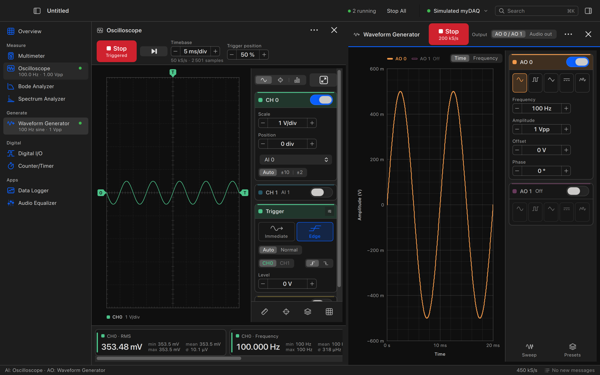
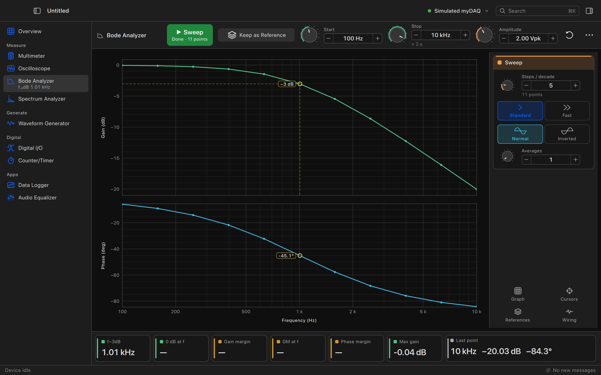
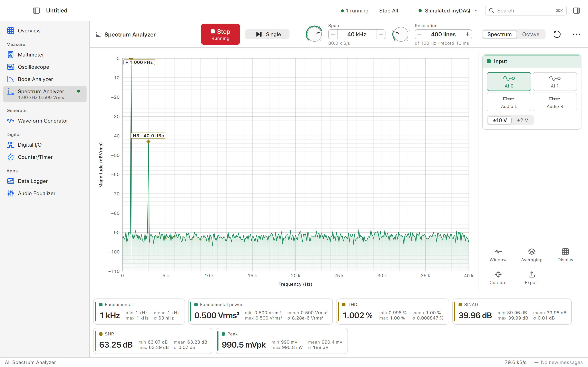
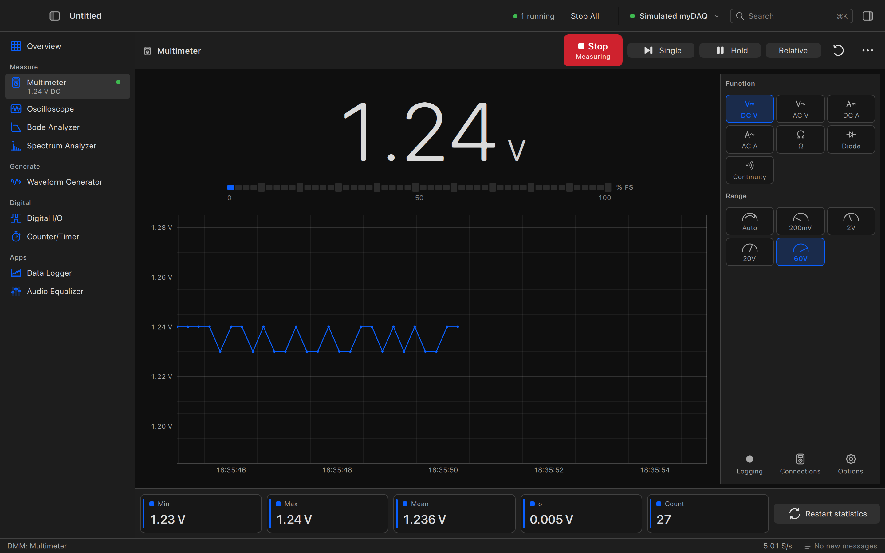
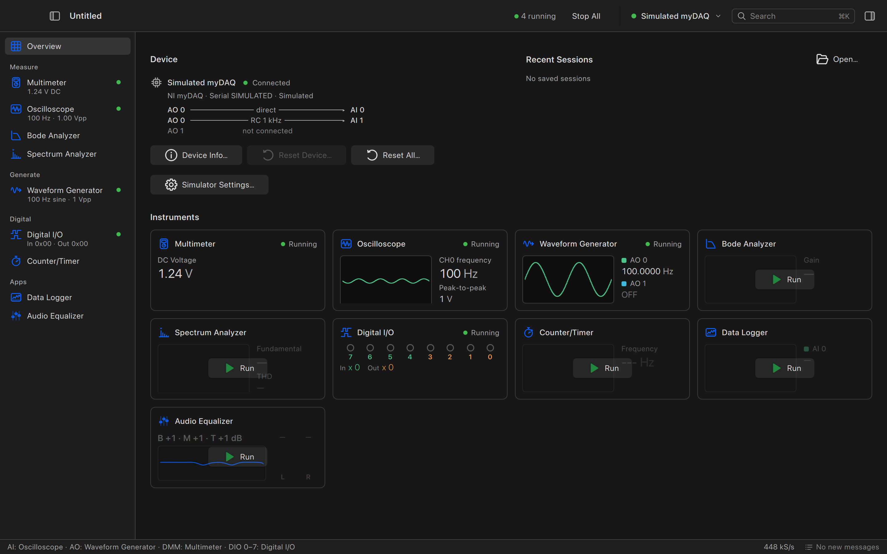

# MYBENCH

**Open-source instrument software for the NI myDAQ.** Multimeter, oscilloscope, waveform
generator, Bode and spectrum analyzers, digital I/O, counter/timer, data logger and audio
equalizer in one window, on macOS, Linux and Windows.

MYBENCH is a replacement for NI ELVISmx. It talks to the myDAQ directly over USB with its own
small driver library, [`libmydaq`](docs/libmydaq.md) (C, libusb), so you don't need any NI
software installed. No myDAQ at hand? A simulated one is built in, and every instrument works
with it.



> **Beta.** Everything runs on the simulator and has been used on a real myDAQ from macOS.
> Windows and Linux with real hardware have had little testing so far, so bug reports are very
> welcome.

## Download

Grab the latest build from the [Releases page](https://github.com/elektricM/mybench/releases):

| | |
|---|---|
| macOS 14+ (Apple Silicon and Intel) | `.dmg` |
| Windows 10/11 | `.exe` installer or portable `.zip` |
| Linux | `.flatpak`, `.AppImage`, or `.deb` / `.rpm` for Ubuntu 26.04 / Fedora 44 |

The first launch needs one extra step on each OS: the macOS build isn't notarized, Windows
needs the WinUSB driver for the myDAQ, and Linux needs a udev rule (the `.deb` and `.rpm`
install it for you). [docs/INSTALL.md](docs/INSTALL.md) walks through each one.

## Instruments

| | |
|---|---|
| **Multimeter** | DC/AC volts and amps, resistance, diode, continuity with tone; trend chart, statistics, hold, relative, logging |
| **Oscilloscope** | AI0/AI1 and audio in, edge and immediate triggers, draggable trigger level and position, measurements, math, FFT, XY, persistence, reference traces, roll mode |
| **Waveform Generator** | AO0 and AO1 independently: standard shapes, sweeps, arbitrary waveforms from the built-in editor, DC level |
| **Bode Analyzer** | gain and phase sweeps, −3 dB and margin markers, reference curves, export |
| **Spectrum Analyzer** | windows, averaging, harmonics, THD/SINAD/SNR, spectrogram, 1/3-octave view |
| **Digital I/O** | per-line direction, LEDs and switches, patterns, timeline |
| **Counter/Timer** | frequency, period, pulse width, edge counting, encoders, pulse-train output |
| **Data Logger** | long AI0/AI1 and multimeter recordings to text files |
| **Audio Equalizer** | audio in → 3-band EQ → audio out in real time |

Run several at once and put two side by side. MYBENCH keeps track of which instrument owns the
analog input and output, and tells you when one has to give way to another. Sessions
(`.mybench` files) save your layout and every instrument's settings.

<p>
  
  
</p>
<p>
  
  
</p>

## Trying it without hardware

Without a myDAQ, or with `--simulated`, MYBENCH uses a simulated device with a small test
circuit wired to it: AO0 drives AI0 directly and AI1 through an RC low-pass (1 kHz), and audio
out loops back to audio in. So the scope shows the generator's output, and a Bode sweep finds a
real −3 dB corner. You can change the circuit from the Overview page.

```sh
mybench --simulated
mybench --panel scope --split gen --run scope,gen   # open a layout directly
mybench session.mybench
```

## Building from source

You need CMake ≥ 3.21, a C11/C++20 compiler, Qt ≥ 6.9 (Quick, Quick Controls 2, ShaderTools,
Svg; Multimedia optional) and libusb-1.0.

```sh
# macOS with Homebrew
brew install cmake ninja qt libusb pkgconf
cmake -S . -B build -G Ninja -DCMAKE_BUILD_TYPE=Release -DCMAKE_PREFIX_PATH=$(brew --prefix qt)
cmake --build build
MYBENCH_NO_USB=1 QT_QPA_PLATFORM=offscreen ctest --test-dir build -LE hw   # tests, no hardware
open build/app/MYBENCH.app
```

Linux, Windows and the packaging steps are in [docs/BUILDING.md](docs/BUILDING.md).

## Other tools

The myDAQ's analog inputs also work live in PulseView and sigrok-cli (a libsigrok driver) and
in ngscopeclient (through a small bridge). See [docs/integrations.md](docs/integrations.md).

## How it works

| Path | |
|---|---|
| [`libmydaq/`](libmydaq) | the USB driver: plain C11 + libusb, usable on its own |
| [`core/`](core) | C++ device layer, simulated myDAQ, signal processing |
| [`ui/`](ui) | shared QML modules: device hub, controls, GPU-drawn plots |
| [`instruments/`](instruments) | one module per instrument |
| [`app/`](app) | the application window |
| [`integrations/`](integrations) | sigrok driver and ngscopeclient bridge |
| [`packaging/`](packaging) | macOS bundle, Linux desktop files, Flatpak, AppImage, Windows installer |

Further reading: [architecture](docs/ARCHITECTURE.md), [UI design](docs/UI.md),
[USB protocol](docs/protocol.md) and [driver status per subsystem](docs/libmydaq.md).

The USB protocol was worked out for interoperability, from USB captures of the myDAQ and from
observing NI's software. No NI code, firmware, driver files, help text or artwork is part of
this repository.

## License

MYBENCH is free software under the [GNU GPL v3 or later](LICENSE). The `libmydaq` driver library
is under the [GNU LGPL v2.1 or later](libmydaq/COPYING.LESSER), so other programs can use it.
The sigrok driver in `integrations/sigrok/` is GPL-3.0-or-later. Bundled third-party components
keep their own licenses (Qt: LGPL-3.0, libusb: LGPL-2.1).

MYBENCH is an independent project, not affiliated with or endorsed by NI (Emerson). "NI",
"myDAQ" and "ELVIS" are trademarks of their owners.
